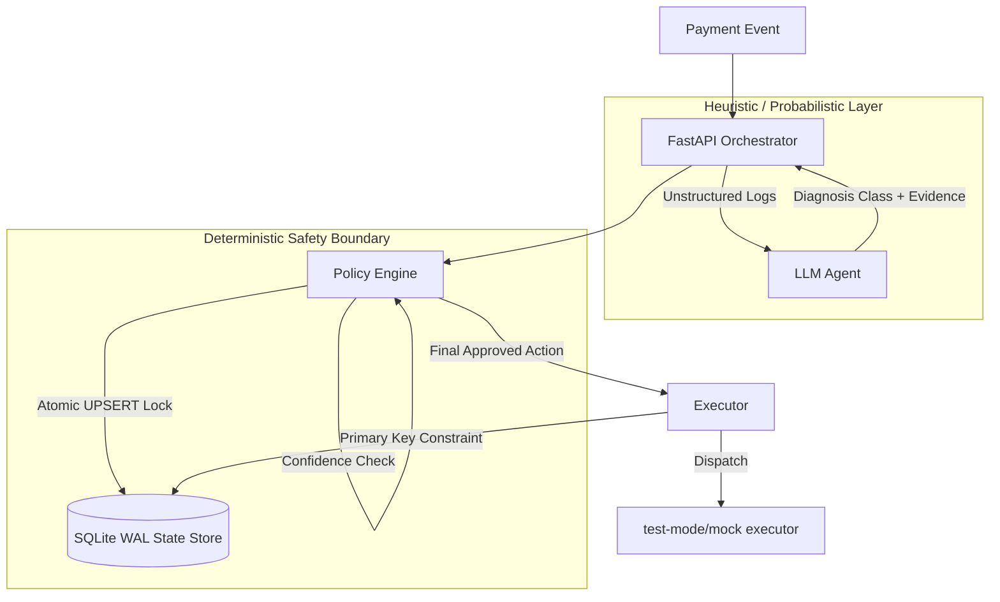

# 🛡️ AI Revenue Recovery Agent

> **Razorpay AI Buildathon 2026 — Track 03: AI Revenue Recovery**  
> *Autonomous, Policy-Bounded Recurring Billing Recovery Engine for India's 850M+ UPI AutoPay Mandates.*
 
[](https://nodejs.org/)
[](https://expressjs.com/)
[](https://ai.google.dev/)
[](https://razorpay.com/)
[-10b981?style=flat-square)](./tests/run_tests.js)
[](./package.json)

---

## 📌 Key Metrics at a Glance

| 💰 At-Risk Pool | 🎯 AI Recovery Rate | 📈 Net AI Uplift | 📊 True Incremental Lift | 🛡️ Test Suite |
| :---: | :---: | :---: | :---: | :---: |
| **₹31,894.00** | **80.3% (₹25,596)** | **+24.2%** vs. Naive | **+43.2%** vs. Control | **42/42 Passing** |

---

## 💡 Overview

In India, over **20 million recurring debits bounce monthly** across UPI AutoPay and e-mandates. Traditional billing systems rely on static 24-hour retries that exhaust customer patience and drive involuntary churn.

The **AI Revenue Recovery Agent** combines **ML-driven diagnosis** and **salary-cycle intelligence** with a **deterministic policy engine** to safely recover failed recurring payments without human fatigue or double-billing risks.

---

## 🏗️ System Architecture

We enforce a strict **"LLM Proposes, Deterministic Safety Engine Decides"** trust boundary. The LLM acts purely as an advisory classifier, while deterministic rules govern all payment executions and retries.



### Architectural Highlights
- **Heuristic / Probabilistic Layer**: Ingests failed webhooks, runs regex & Gemini 1.5 Flash LLM diagnostic classification, and computes recovery probabilities via an 8-feature Logistic Regression scorer.
- **Deterministic Safety Boundary**: Enforces atomic state locking, economic floors ($<₹100$), ML probability floors ($P < 0.15$), and strict 3-retry dunning caps (fixing Polar Bug #10811).
- **Execution & Dispatch Layer**: Executes tokenized S2S charges via Razorpay test mode and dispatches personalized Hinglish WhatsApp nudges with delivery tracking.

---

## 💎 Core Capabilities

- **🧠 ML Recovery Scorer**: 8-feature Logistic Regression model trained via Batch Gradient Descent to predict payment recovery probabilities.
- **🇮🇳 Salary-Cycle Mode Inference**: Analyzes historical debit patterns to detect customer payday cycles (1st, 7th, 28th) and schedules retries accordingly.
- **🛡️ Deterministic Safety Rules**: Prevents double-charges using atomic file locks and isolates automated dunning from customer manual retries.
- **📈 Quantified Baseline Simulator**: Benchmarks live performance against naive $T+24h$ retries and a 15% stratified holdout control group.
- **💬 Hinglish Recovery Nudges**: Generates contextual, localized WhatsApp recovery reminders with asynchronous delivery status tracking.

---

## ⚡ Quickstart Guide

### 1. Installation
```bash
git clone https://github.com/Kiran460309/ai-revenue-recovery.git
cd "AI Revenue Recovery"
npm install
```

### 2. Configure Environment (Optional)
Create a `.env` file in the root directory:
```env
PORT=3000
GEMINI_API_KEY=your_gemini_api_key_here
RAZORPAY_KEY_ID=rzp_test_your_id
RAZORPAY_KEY_SECRET=your_secret_key
```
*(Note: If API keys are omitted, the engine automatically uses heuristic regex fallbacks and local mock providers).*

### 3. Run Tests
```bash
npm test
```

### 4. Start Application
```bash
npm start
```
Open **[http://localhost:3000](http://localhost:3000)** to view the live dashboard pre-populated with synthetic transaction data.

---

## 📡 REST API Reference

| Method | Endpoint | Description |
| :--- | :--- | :--- |
| `POST` | `/api/events/failed-payment` | Ingests a failed payment and triggers recovery workflow. |
| `POST` | `/api/test/run-batch` | Runs a 20-transaction synthetic batch recovery simulation. |
| `GET` | `/api/report/recovery-rate` | Returns recovery rates and transaction statistics. |
| `GET` | `/api/report/baseline-comparison` | Returns AI recovery vs. Naive baseline & holdout metrics. |
| `GET` | `/api/nudges` | Returns dispatched WhatsApp/SMS recovery nudges. |
| `GET` | `/api/payments/:id/audit-trail` | Returns the complete audit trail and decision log. |
| `POST` | `/api/payments/:id/manual-retry` | Triggers a manual customer retry without exhausting dunning limit. |
| `POST` | `/api/test/inject-failure` | Toggles simulated 504 gateway timeout failure injection. |

---

## 🧪 Verification & Test Suite

The engine includes **42 automated assertions** across **9 test groups**:
- ✅ Polar Bug Dunning Stopping Rules
- ✅ Classifier Mapping Accuracy & LLM Fallbacks
- ✅ Salary Cycle Mode Statistical Inference
- ✅ Economic Floor Threshold Enforcement
- ✅ Idempotency Locks & Concurrency Controls
- ✅ Baseline Simulation & Net Uplift Verification
- ✅ ML Scorer Training & Convergence
- ✅ Nudge Dispatch & Delivery State Tracking
- ✅ Stratified Holdout Group Incrementality Math

---

## 👥 Project Info

- **Author:** Kiran.S 
- **Event:** Razorpay AI Buildathon 2026 (Track 03: AI Revenue Recovery)
- **License:** [MIT](./package.json)
